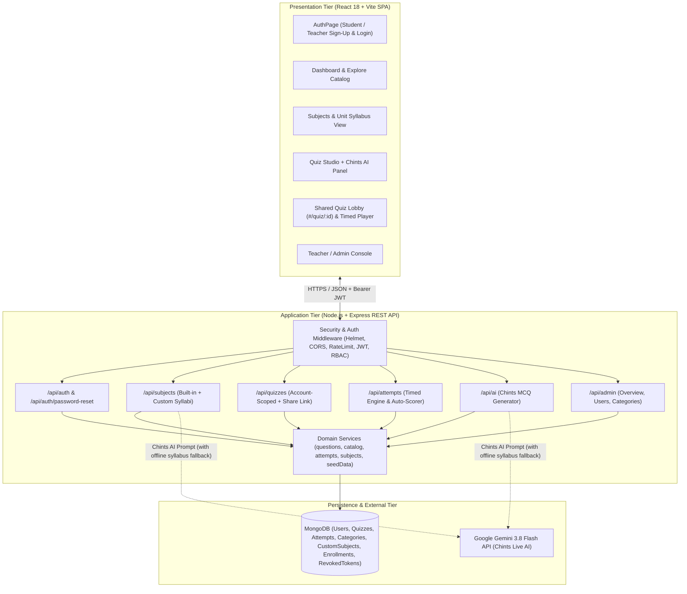
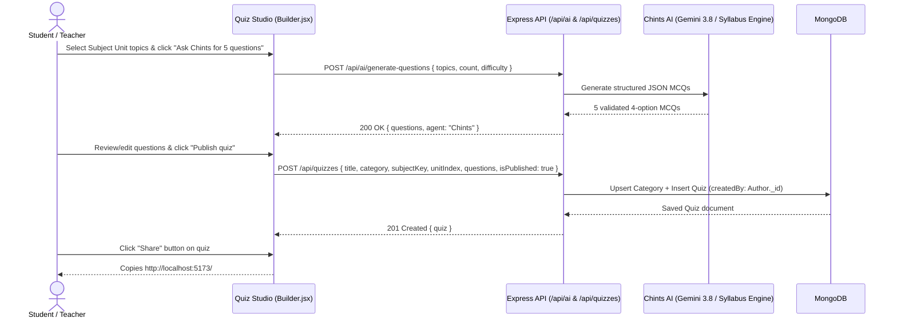
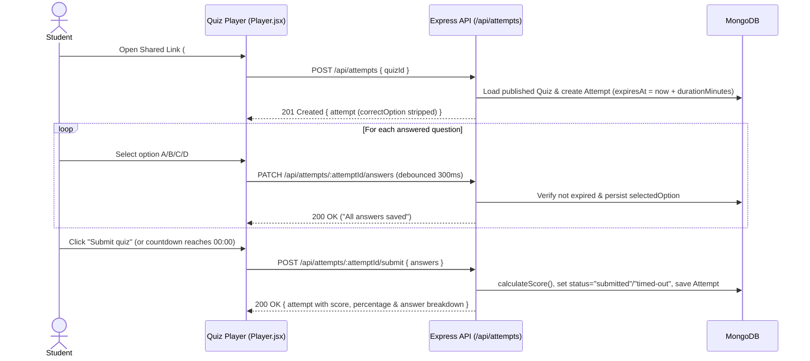

# Software Architecture & Design (SAD) Specification

- **Project Name:** Online Quiz Management System  
- **Document Version:** 2.0 (Sprint 3 Final Release)  
- **Standard:** IEEE Std 1016 – Software Design Descriptions  

---

## 1. Introduction

### 1.1 Purpose
This Software Architecture & Design (SAD) Specification describes the architectural pattern, component decomposition, UML sequence interactions, RESTful API design, security architecture, error-handling protocols, and documented Sprint-3 design evolutions of the **Online Quiz Management System**.

### 1.2 Scope
The system is a full-stack web application enabling **Students** and **Teachers (Admins)** to browse structured university subjects and syllabus units, author quizzes manually or with the **Chints AI** assistant, share direct test links (`#/quiz/:quizId`), take timed auto-scored assessments, and review detailed performance analytics.

---

## 2. Architectural Pattern & Component Architecture

### 2.1 Architectural Pattern
The system follows a **3-Tier Layered Client–Server Architecture** (Presentation Tier, Stateless REST API + Service Tier, and Document Persistence Tier) with an external **AI Integration Adapter** for **Chints** (Google Gemini 3.8 Flash + built-in syllabus fallback engine).

### 2.2 Component Diagram

---

## 3. Detailed Design & UML Sequence Diagrams

### 3.1 Sequence Diagram 1: Chints AI Quiz Generation, Publishing & Sharing

### 3.2 Sequence Diagram 2: Timed Quiz Attempt, Auto-Save & Auto-Scoring

---

## 4. REST API Design Specification

| Endpoint | Method | Auth / Role | Description |
| :--- | :--- | :--- | :--- |
| `/api/health` | `GET` | Public | Health check returning `{ status: "ok" }` |
| `/api/auth/register` | `POST` | Public (Rate-limited) | Registers account (`role: "student"` → `user`, `role: "teacher"` → `admin`) |
| `/api/auth/login` | `POST` | Public (Rate-limited) | Authenticates user and issues 2-hour signed JWT |
| `/api/auth/logout` | `POST` | `requireAuth` | Revokes current JWT via SHA-256 hash in `RevokedToken` |
| `/api/subjects` | `GET` | `requireAuth` | Lists 5 built-in courses + user's custom syllabi with enrollment state |
| `/api/subjects/custom` | `POST` | `requireAuth` | Parses pasted syllabus with Chints into units/topics & enrolls user |
| `/api/subjects/:key/state` | `PATCH` | `requireAuth` | Updates subject state (`enrolled`, `dropped`, `hidden`) |
| `/api/quizzes` | `GET` | `optionalAuth` | Returns starter + own quizzes for Students; returns **all** published quizzes for Teachers/Admins |
| `/api/quizzes/by-unit` | `GET` | `requireAuth` | Lists unit quizzes (account-scoped for Students; all accounts for Teachers) |
| `/api/quizzes/mine` | `GET` | `requireAuth` | Lists user's own quizzes (or `scope=all` for Teachers/Admins) |
| `/api/quizzes/:quizId` | `GET` | Public Share Link | Loads a published quiz by ID for the `#/quiz/:quizId` shared test page |
| `/api/quizzes` | `POST` | `requireAuth` | Creates a new quiz (auto-creates category if needed) |
| `/api/quizzes/:quizId` | `PUT` / `PATCH` / `DELETE` | Owner or Admin | Updates or deletes a quiz |
| `/api/ai/generate-questions` | `POST` | `requireAuth` | Uses **Chints** (Gemini 3.8 Flash + offline syllabus engine) to draft MCQs |
| `/api/attempts` | `POST` | `requireAuth` | Starts a timed attempt (`expiresAt = startedAt + durationMinutes`) |
| `/api/attempts/:id/answers` | `PATCH` | `requireAuth` | Auto-saves selected options during an active attempt |
| `/api/attempts/:id/submit` | `POST` | `requireAuth` | Grades attempt and returns question-by-question review |
| `/api/admin/overview` | `GET` | `requireAdmin` (Teacher) | Platform KPIs (users, teachers, published/draft quizzes, average score) |
| `/api/admin/users` | `GET` / `PATCH` | `requireAdmin` (Teacher) | Lists users and promotes/demotes between Student and Teacher |

---

## 5. Security Architecture & Error Handling Protocol

1. **Authentication & Token Revocation:** Passwords are hashed with `bcryptjs` (cost 12). JWTs expire after 2 hours and carry a `ver` (`tokenVersion`) claim. Logging out writes the token's SHA-256 digest to `RevokedToken` (indexed with MongoDB TTL expiration), and resetting a password increments `tokenVersion` to invalidate all active tokens.
2. **Account-Scoped Privacy & Teacher Oversight:** Quizzes created or generated by a Student remain private to that Student's catalog/unit listings so other students' dashboards are never cluttered. Teachers (`role: "admin"`) have full oversight across all student and teacher quizzes. Any published quiz can be shared via its direct `#/quiz/:quizId` link.
3. **Standardized Error Handling (`src/middleware/errorHandler.js`):**
   - Malformed JSON → `HTTP 400 { message: "Request body must be valid JSON" }`
   - Mongoose `ValidationError` → `HTTP 400 { message: "Invalid data", details }`
   - Duplicate key (`11000`) → `HTTP 409 { message: "A record with this value already exists" }`
   - Unhandled exceptions → logged server-side and returned as `HTTP 500 { message: "Internal server error" }` without leaking stack traces.

---

## 6. Documented Deviations & Evolution from Initial SRS/SAD (For Final Demo & Viva)

In accordance with the project evaluation guidelines (*"Deviations from the initially submitted SRS, SAD, and Test Plan are acceptable, provided they are documented and logically explained"*):

1. **Migration from Flask/SQLite Prototype to MERN Stack (Sprint 1–2):** Upgraded from server-rendered templates to a decoupled React 18 SPA + Express/MongoDB REST API with JWT authentication and GitHub Actions CI.
2. **Addition of Subject & Unit Curriculum Hierarchy + Custom Syllabus Parser (Sprint 3):** Carried forward the 5 core university subjects (`SE`, `UIUX`, `KOTLIN`, `DBMS`, `ML`) and custom syllabus parser from the prototype into MongoDB (`CustomSubject`, `SubjectEnrollment`).
3. **Chints AI Question Generator with Dual-Mode Resilience (Sprint 3):** Integrated Google `gemini-3.8-flash` for live AI question generation and syllabus parsing, paired with a built-in syllabus fallback engine so demos succeed even on machines without an external API key.
4. **Student vs. Teacher Role Selector & Shareable Test Links (Sprint 3):** Added explicit **Student** and **Teacher (Admin)** account selection at sign-up, account-private generated quizzes for students, full Teacher oversight, and one-click `#/quiz/:quizId` share links.

---

## 9. Component Responsibility Matrix

| Layer | Module / File | Primary Responsibility |
| :--- | :--- | :--- |
| **Presentation** | `client/src/Subjects.jsx` | Course enrollment, unit exploration, and custom syllabus upload modal |
| **Presentation** | `client/src/Builder.jsx` | Chints AI Studio prompt controls, question review, and quiz publishing |
| **Presentation** | `client/src/Manage.jsx` | Personal quiz workspace (`MyQuizzes`), attempt review (`History`), and `TeacherConsole` |
| **API Routing** | `server/src/routes/subjects.js` | Built-in/custom subject catalog, enrollment, and syllabus parsing endpoints |
| **API Routing** | `server/src/routes/ai.js` | Live Gemini 3.8 Flash MCQ generation and deterministic syllabus fallback |
| **Domain Service** | `server/src/services/catalog.js` | Pagination, regex-safe search normalization, and public quiz serialization |
